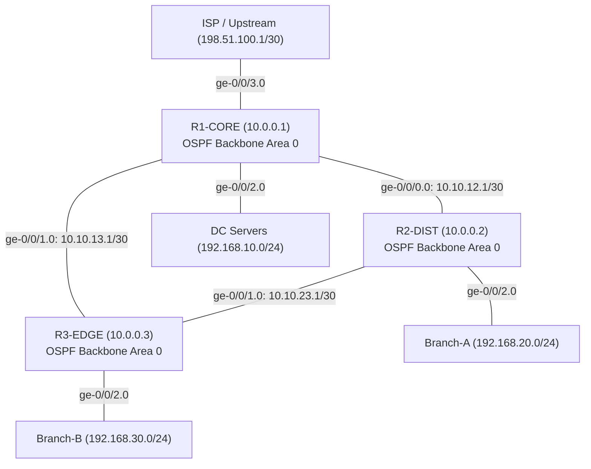

# JunosNOC Virtual Lab Topology & Architecture

This lab models an enterprise multi-tier routing architecture running **Juniper Junos OS** (vSRX, vMX, or vJunos-router). It provides redundant core-to-distribution routing, OSPF dynamic routing convergence, static upstream default routing, and full SSH/NETCONF programmatic access.

---

## 1. Physical & Logical Topology



---

## 2. IP Addressing Scheme

| Device | Interface | IP Address | Subnet Mask | Description | OSPF Area |
| :--- | :--- | :--- | :--- | :--- | :--- |
| **R1-CORE** | `lo0.0` | `10.0.0.1` | `/32` | Router-ID / Loopback | Area 0 (Passive) |
| | `ge-0/0/0.0` | `10.10.12.1` | `/30` | P2P Link to R2-DIST | Area 0 |
| | `ge-0/0/1.0` | `10.10.13.1` | `/30` | P2P Link to R3-EDGE | Area 0 |
| | `ge-0/0/2.0` | `192.168.10.1` | `/24` | Data Center LAN Gateway | Area 0 (Passive) |
| | `ge-0/0/3.0` | `198.51.100.2` | `/30` | WAN / Internet Uplink | Static Route Only |
| | `fxp0.0` | `192.168.1.11` | `/24` | Out-Of-Band Management | Mgmt Network |
| **R2-DIST** | `lo0.0` | `10.0.0.2` | `/32` | Router-ID / Loopback | Area 0 (Passive) |
| | `ge-0/0/0.0` | `10.10.12.2` | `/30` | P2P Link to R1-CORE | Area 0 |
| | `ge-0/0/1.0` | `10.10.23.1` | `/30` | P2P Link to R3-EDGE | Area 0 |
| | `ge-0/0/2.0` | `192.168.20.1` | `/24` | Branch-A LAN Gateway | Area 0 (Passive) |
| | `fxp0.0` | `192.168.1.12` | `/24` | Out-Of-Band Management | Mgmt Network |
| **R3-EDGE** | `lo0.0` | `10.0.0.3` | `/32` | Router-ID / Loopback | Area 0 (Passive) |
| | `ge-0/0/0.0` | `10.10.13.2` | `/30` | P2P Link to R1-CORE | Area 0 |
| | `ge-0/0/1.0` | `10.10.23.2` | `/30` | P2P Link to R2-DIST | Area 0 |
| | `ge-0/0/2.0` | `192.168.30.1` | `/24` | Branch-B LAN Gateway | Area 0 (Passive) |
| | `fxp0.0` | `192.168.1.13` | `/24` | Out-Of-Band Management | Mgmt Network |

---

## 3. Routing & Protocol Architecture

### OSPF Design
- **Backbone Area `0.0.0.0`**: Runs across all inter-router transit links (`10.10.12.0/30`, `10.10.13.0/30`, `10.10.23.0/30`).
- **Passive Interfaces**: Loopbacks (`lo0.0`) and LAN subnets (`ge-0/0/2.0`) are declared as `passive` under OSPF to advertise the prefixes without forming neighbor adjacencies on host-facing links.
- **Reference Bandwidth**: Explicitly configured under `protocols ospf reference-bandwidth 10g` to handle multi-gigabit link metric calculation.

### Static Routing & Redundancy
- **R1-CORE** holds a static default route (`0.0.0.0/0 next-hop 198.51.100.1`) pointing to the simulated WAN upstream.
- Default route is redistributed or injected into OSPF using export policy.
- Triangle topology ensures that if the direct link `R1-CORE <-> R3-EDGE` goes down, traffic automatically reconverges across `R1-CORE <-> R2-DIST <-> R3-EDGE` without packet loss.

### NETCONF & SSH Access
- Each device exposes Junos NETCONF over SSH subsystem on port 830 (and standard SSH on port 22).
- System services configured:
  ```junos
  set system services ssh
  set system services netconf ssh
  set system login user junos-admin class super-user authentication plain-text-password
  ```

<!-- Enterprise Topology Revision: October 2026 -->
